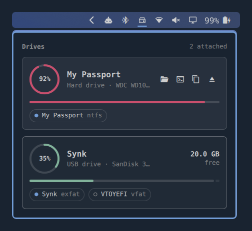
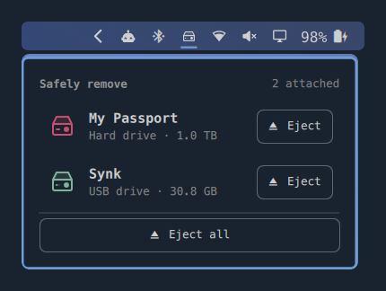

# Drives for Omarchy

<p align="center">
  
</p>

A minimal drive control for the Omarchy bar. A small external-drive icon appears while a USB stick, SD card or external SSD, HDD or NVMe drive is attached, whether by USB-A, USB-C or Thunderbolt. It disappears when the last one is removed. Your laptop's own disks are never listed.

Click it for a card per drive: a ring and a strip showing how full it is, coloured green, yellow or red with your theme, and its filesystems. Right-click for a list to eject drives safely. It uses your Omarchy theme, font and language.

| Hover a card for actions | Right-click to eject |
|---|---|
|  |  |

| The bar icon | A notification |
|---|---|
|  |  |

## Install

```bash
omarchy plugin add https://github.com/Profit94/omarchy-drives.git --enable
omarchy bar move softwave.drives --before omarchy.network
```

Plugins run unsandboxed inside the Omarchy shell, so review the code before installing it.

## Controls

| Input | Action |
|---|---|
| Left-click | Open the drive cards |
| Right-click | Open the eject list |
| Middle-click | Open the most recently attached drive in the file manager |
| Hover a card | Show Open, Open in terminal, Copy path and Eject |
| Click a filesystem chip | Mount or unmount it |
| Eject all | Eject every drive, one after another |

## What it does

- **Attach.** The icon appears the moment a USB storage device is plugged in, with its light blinking while a hard drive spins up. The drive is mounted and opened in your file manager as soon as it is ready, and you get a notification.
- **Eject.** File manager windows showing the drive are closed first, because they keep it busy. The drive is then unmounted and powered off. If another app still holds it, the notification says which one.
- **Removal.** A notification tells you when a drive can be unplugged, and warns you if one was pulled out while still in use.
- **Pixel-sharp.** Outlines, text and the icon are snapped to whole screen pixels at any display scale, including fractional ones such as 1.25×.

## Settings

Set these with `omarchy bar set softwave.drives <key> <value> --json`.

| Key | Default | Meaning |
|---|---|---|
| `autoOpen` | `true` | Open a newly attached drive in the file manager |
| `notify` | `true` | Notify when a drive is attached, ejected or removed |
| `alwaysShow` | `false` | Keep the icon in the bar when no drive is attached |

IPC: `omarchy-shell softwave.drives.actions openLatest | ejectLatest | openDetails | openEject | refresh`.

## Languages

The panels and notifications follow Omarchy's language (Setup > Language), live and without a restart, in all 50 languages Omarchy ships. Sizes and percentages use the language's number format, and right-to-left languages are mirrored. The translations have not been reviewed by native speakers, so corrections in `i18n/<code>.json` are welcome.

## Privacy and performance

- It reads drives from udisks and `lsblk`, and watches USB events with `udevadm`. Nothing is sent anywhere.
- Notification icons are written to `$XDG_RUNTIME_DIR/softwave-drives`.
- At rest nothing moves, and the icon uses no measurable CPU. While a drive ejects, only its light blinks, twice a second. That measured about 0.5% of one CPU core in the shell, on an Intel HD Graphics 620 laptop. Animations stop with `omarchy toggle animations`.

## Known issues

- Notification icons sit half a pixel off vertically. Omarchy's notification card places its icon slot there, and a plugin can't change that.
- If a drive is open only in a background file manager tab, its window isn't closed on eject. The eject then fails and names the file manager to close.

## Requirements

Omarchy, plus tools it already installs: udisks2, util-linux, systemd, glib2 (`gio`), libnotify, jq, wl-clipboard and xdg-terminal-exec. No other packages are needed.

## Tests

```bash
node tests/model.test.js
node tests/i18n.test.js
```
